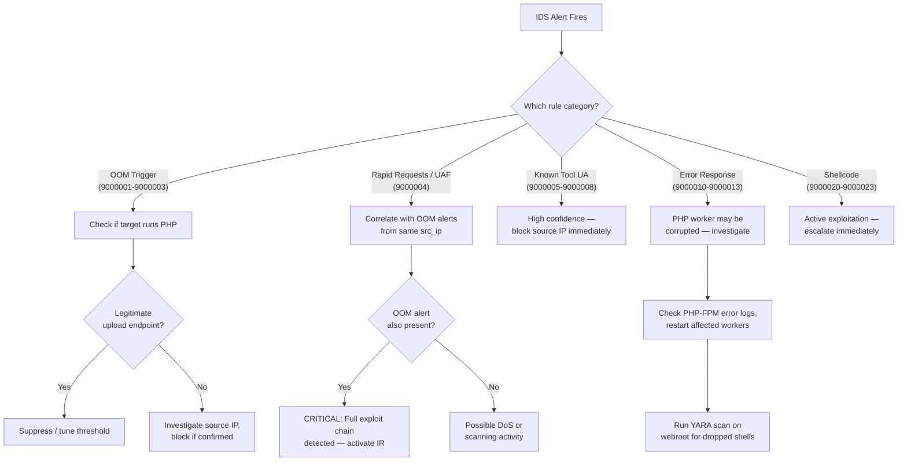

# PHP2Shell Detection Rules

Defensive detection rules for identifying exploitation attempts and post-exploitation artifacts related to:

| CVE | Vulnerability | Vector |
|-----|---------------|--------|
| **CVE-2026-109618** | OOM → Uninitialized Memory Corruption | Crafted HTTP requests causing PHP memory exhaustion during request parsing |
| **CVE-2026-109619** | Use-After-Free via stale global state | Error recovery leaving dangling pointers; exploitable by subsequent requests on the same PHP-FPM worker |

Both vulnerabilities are **unauthenticated** and **remotely exploitable** via crafted HTTP requests.

---

## Rule Sets

| Directory | Engine | SID Range | File |
|-----------|--------|-----------|------|
| `suricata/` | Suricata 6+ | 9000001–9000099 | `php2shell.rules` |
| `snort/` | Snort 3 | 9001001–9001099 | `php2shell.rules` |
| `yara/` | YARA 4+ | — | `php2shell.yar` |

---

## Deployment

### Suricata

```bash
# 1. Copy rules to the Suricata rules directory
sudo cp suricata/php2shell.rules /etc/suricata/rules/

# 2. Add to suricata.yaml under rule-files:
#    rule-files:
#      - php2shell.rules

# 3. Validate syntax
sudo suricata -T -c /etc/suricata/suricata.yaml

# 4. Reload rules (live)
sudo suricatasc -c reload-rules

# 5. Verify rules loaded
sudo suricatasc -c "ruleset-stats"
```

> [!IMPORTANT]
> Ensure `$HTTP_SERVERS` and `$EXTERNAL_NET` address groups are correctly defined in `suricata.yaml` for your network topology.

**Required Suricata configuration:**

```yaml
# Enable HTTP parsing (required for http.* sticky buffers)
app-layer:
  protocols:
    http:
      enabled: yes
      libhtp:
        request-body-limit: 0    # Do not truncate request bodies
        response-body-limit: 0   # Do not truncate response bodies
```

### Snort 3

```bash
# 1. Copy rules to your Snort rules directory
sudo cp snort/php2shell.rules /etc/snort/rules/

# 2. Reference in snort.lua or your policy configuration:
#    ips = {
#        include = '/etc/snort/rules/php2shell.rules'
#    }

# 3. Validate
snort -c /etc/snort/snort.lua -R /etc/snort/rules/php2shell.rules --warn-all

# 4. Reload
snort --reload
```

### YARA

```bash
# Scan a directory recursively
yara -r yara/php2shell.yar /var/www/

# Scan with multiple threads
yara -p 8 -r yara/php2shell.yar /var/www/

# Scan a memory dump
yara yara/php2shell.yar /path/to/memory.dump

# Scan a process by PID (Linux)
yara yara/php2shell.yar /proc/<pid>/mem

# Compile rules for faster repeated scanning
yarac yara/php2shell.yar php2shell.yarc
yara php2shell.yarc /var/www/
```

> [!TIP]
> Pre-compile YARA rules with `yarac` for production deployments—compiled rules load ~10× faster and skip the parsing step on each run.

---

## Rule Coverage Matrix

| Attack Stage | Suricata SID | Snort SID | YARA Rule |
|--------------|-------------|-----------|-----------|
| Oversized Content-Length (OOM) | 9000001 | 9001001 | — |
| Nested multipart boundaries | 9000002 | 9001002 | — |
| Padding/spray in POST body | 9000003 | 9001003 | — |
| Rapid sequential requests (UAF) | 9000004 | 9001004 | — |
| Known exploit User-Agents | 9000005–9000008 | 9001005–9001008 | — |
| PHP OOM fatal error response | 9000010 | 9001010 | — |
| Heap corruption error response | 9000011–9000013 | 9001011–9001013 | — |
| NOP sled in POST body | 9000020 | 9001020 | — |
| x86/x64 shellcode in POST body | 9000021–9000022 | 9001021–9001022 | — |
| Base64-encoded command exec | 9000023 | 9001023 | — |
| Two-stage OOM→UAF chain | 9000030–9000031 | — | — |
| PHP-FPM connection exhaustion | 9000040 | 9001040 | — |
| Exploit tool on disk | — | — | `PHP2Shell_Exploit_Tool` |
| PoC source code | — | — | `PHP2Shell_PoC_Source_Code` |
| Post-exploitation webshell | — | — | `PHP2Shell_Webshell_PostExploit` |
| Memory dump artifacts | — | — | `PHP2Shell_Memory_Artifact` |
| Compiled exploit binary | — | — | `PHP2Shell_Compiled_Exploit` |
| Obfuscated PHP payload | — | — | `PHP2Shell_Obfuscated_Payload` |

---

## Tuning Recommendations

### Threshold Adjustments

| Rule | Parameter | Default | Guidance |
|------|-----------|---------|----------|
| Oversized Content-Length (SID 9000001/9001001) | Regex digit count | `\d{9,}` (≥ 1 GB) | Lower to `\d{8,}` (≥ 10 MB) for restrictive environments; raise for file-upload-heavy apps |
| Rapid requests (SID 9000004/9001004) | `count` / `seconds` | 10 req / 2 sec | Increase count for high-traffic APIs; decrease seconds for more sensitive detection |
| PHP-FPM connections (SID 9000040/9001040) | `count` / `seconds` | 50 SYN / 5 sec | Adjust based on expected connection concurrency from legitimate load balancers |
| Nested boundaries (SID 9000002/9001002) | Boundary count | 4 nested | Reduce to 3 for paranoid mode; most legitimate forms use 1 boundary |

### Environment-Specific Tuning

```yaml
# Example: Suppress OOM rule for known large-file upload endpoint
suppress:
  - gen_id: 1
    sig_id: 9000001
    track: by_dst
    ip: 10.0.1.50    # File upload server
```

> [!WARNING]
> Do **not** globally suppress the rapid-request rule (SID 9000004/9001004) — it is the primary network-level indicator for CVE-2026-109619 UAF exploitation. Instead, whitelist specific source IPs (e.g., health-check probes, load balancer IPs).

---

## False Positive Guidance

### High False-Positive Risk

| Rule(s) | Scenario | Mitigation |
|---------|----------|------------|
| **Oversized Content-Length** (9000001) | Large file uploads, video streaming, backup endpoints | Suppress for specific destination IPs or URI paths serving upload functionality |
| **Rapid requests** (9000004) | API gateways, health checks, load balancer probes, automated testing | Whitelist known source IPs; increase threshold count |
| **Base64 + exec** (9000023) | CMS platforms (WordPress, Drupal) that legitimately use `base64_decode` with dynamic code | Narrow with URI-path matching; combine with other indicators |
| **PHP OOM error** (9000010) | Legitimately memory-hungry PHP applications (image processing, PDF generation) | Correlate with inbound OOM-trigger rules; alert only when both fire |

### Low False-Positive Risk

| Rule(s) | Notes |
|---------|-------|
| **Known User-Agents** (9000005–9000008) | Very specific strings; trivially spoofable but low FP |
| **Heap corruption errors** (9000011–9000013) | Should never appear in production HTTP responses |
| **Two-stage OOM→UAF chain** (9000030–9000031) | Flowbit chaining provides high confidence |
| **NOP sled / shellcode** (9000020–9000022) | Binary content in PHP POST bodies is inherently suspicious |

### YARA False Positive Notes

| Rule | Concern | Recommendation |
|------|---------|----------------|
| `PHP2Shell_Webshell_PostExploit` | Legitimate admin panels, debugging tools, and PHP frameworks may match `eval()` + `base64_decode()` patterns | Review matches manually; whitelist known frameworks by path |
| `PHP2Shell_Obfuscated_Payload` | Commercial PHP applications (e.g., ionCube-encoded) may have high entropy | Exclude known commercial application directories |
| `PHP2Shell_Memory_Artifact` | Legitimate PHP crash dumps may contain `zend_mm_heap corrupted` | Correlate with timeline of suspected attack activity |

---

## SIEM Integration

### Splunk

```spl
# Suricata alerts via eve.json
index=ids sourcetype=suricata
| where alert.signature_id >= 9000001 AND alert.signature_id <= 9000099
| stats count by alert.signature, src_ip, dest_ip, alert.severity
| sort -count

# Correlation: OOM trigger followed by UAF within 30 seconds
index=ids sourcetype=suricata alert.signature_id IN (9000001, 9000002, 9000003)
| transaction src_ip dest_ip maxspan=30s
| join type=inner src_ip dest_ip
    [ search index=ids sourcetype=suricata alert.signature_id=9000004 ]
| table _time, src_ip, dest_ip, alert.signature
```

### Elastic Security (ELK)

```json
// Detection rule — PHP2Shell exploitation attempt
{
  "rule": {
    "name": "PHP2Shell Exploitation Attempt",
    "severity": "critical",
    "type": "query",
    "query": "event.module:suricata AND suricata.eve.alert.signature_id:[9000001 TO 9000099]",
    "threat": [{
      "framework": "MITRE ATT&CK",
      "tactic": { "id": "TA0001", "name": "Initial Access" },
      "technique": [{ "id": "T1190", "name": "Exploit Public-Facing Application" }]
    }]
  }
}
```

```json
// Correlation — multi-stage detection
{
  "rule": {
    "name": "PHP2Shell Multi-Stage Attack Chain",
    "type": "eql",
    "query": "sequence by source.ip, destination.ip with maxspan=30s [any where suricata.eve.alert.signature_id in (9000001, 9000002, 9000003)] [any where suricata.eve.alert.signature_id == 9000004]"
  }
}
```

### QRadar

```aql
-- Custom rule: PHP2Shell exploitation indicators
SELECT sourceip, destinationip, COUNT(*) as hit_count,
       "QID" as qid, "PHP2Shell Alert" as rule_name
FROM events
WHERE qid IN (9000001, 9000002, 9000003, 9000004)
  AND INOFFENSE(sourceip)
GROUP BY sourceip, destinationip
HAVING hit_count > 3
LAST 1 HOURS
```

### Generic Syslog / CEF Forwarding

Suricata's `eve.json` output can be forwarded to any SIEM via syslog or filebeat:

```yaml
# suricata.yaml — EVE output for SIEM ingestion
outputs:
  - eve-log:
      enabled: yes
      filetype: regular
      filename: eve.json
      types:
        - alert:
            payload: yes
            payload-printable: yes
            http-body: yes
            http-body-printable: yes
            metadata: yes
```

---

## Incident Response Workflow

When detection rules fire, follow this triage workflow:



> [!CAUTION]
> If rules 9000030 + 9000031 (two-stage chain) fire together, or if heap corruption error responses (9000011–9000013) appear after OOM triggers, assume **active exploitation is in progress**. Immediately isolate the affected server, restart PHP-FPM workers, and scan the filesystem with the YARA rules.

---

## Testing

Validate that rules load and trigger correctly using the provided lab environment:

```bash
# Test Suricata rules with a PCAP replay
suricata -r test/pcaps/php2shell_oom.pcap -c /etc/suricata/suricata.yaml -l /tmp/suricata-test/
grep "PHP2SHELL" /tmp/suricata-test/eve.json

# Test YARA rules against sample files
yara -r yara/php2shell.yar test/samples/

# Dry-run Snort against a PCAP
snort -c /etc/snort/snort.lua -R snort/php2shell.rules -r test/pcaps/php2shell_oom.pcap --warn-all
```

> [!NOTE]
> Test PCAPs and sample files should be created in the `lab/` directory. See the lab environment documentation for setting up a controlled testing environment with vulnerable PHP versions.

---

## Version History

| Version | Date | Changes |
|---------|------|---------|
| 1.0 | 2026-10-22 | Initial release — Suricata, Snort 3, and YARA rulesets |

---

## License

BSD-3-Clause — See [LICENSE](../LICENSE) in the project root.
